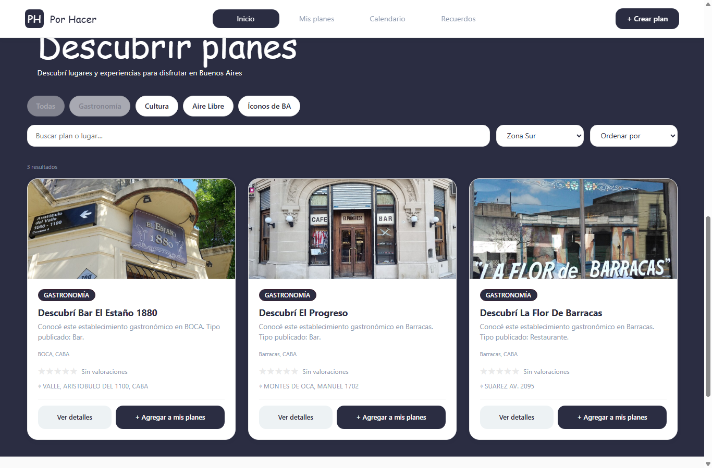
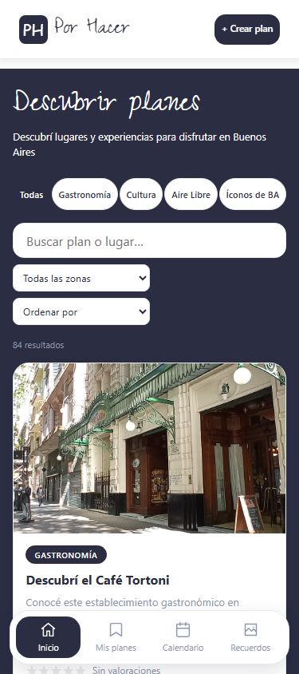
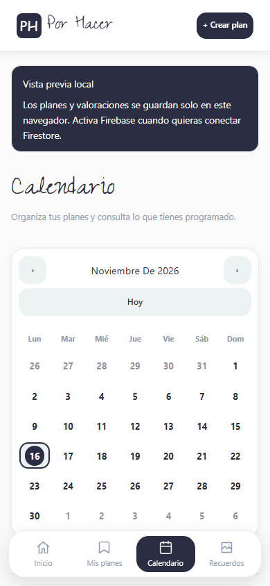
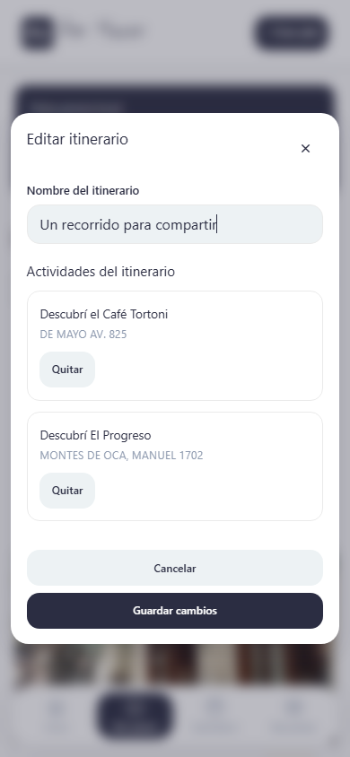
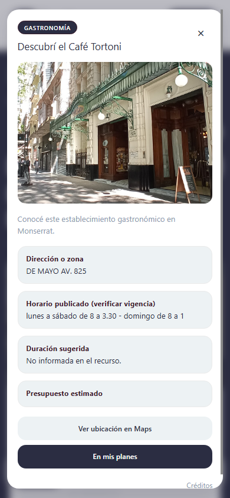
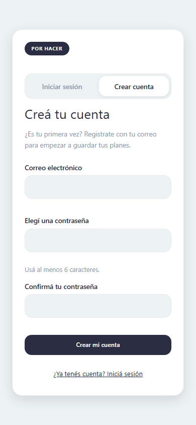

# Evidencias de la versión final

Capturas de Chrome con perfiles aislados y datos sintéticos. No acreditan cuentas reales ni un despliegue de Vercel. Los recursos HTTPS externos se bloquearon en estas pruebas; las fotos del catálogo se cargaron desde archivos incluidos en la aplicación.

## Catálogo en escritorio

## Categorías en móvil

## Calendario

## Itinerarios

## Detalles y créditos

## Registro

## Evidencias pendientes de producción

Agregar captura de la URL final, panel de despliegue con commit/fecha y documento de Firestore de la cuenta de demostración. Omitir contraseñas, claves y datos personales de terceros. No reemplazar estas evidencias por las de emuladores.
